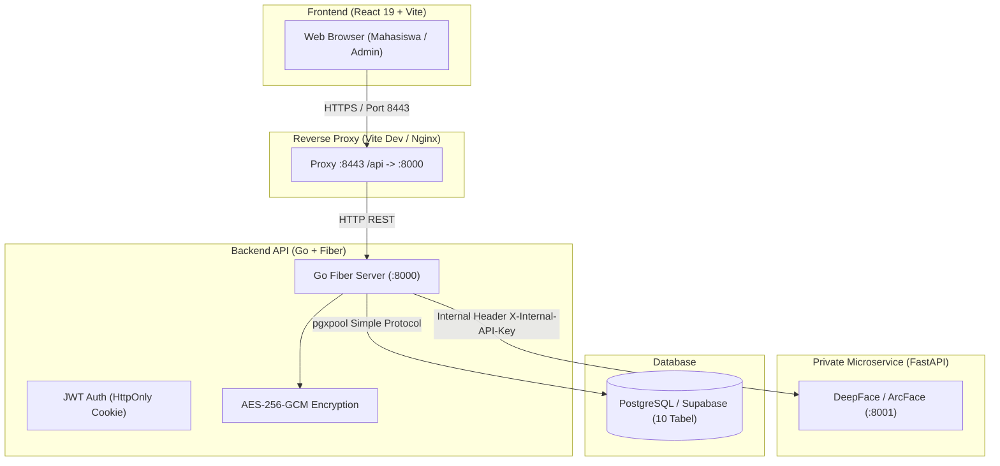

# LabSync

> Sistem Presensi Praktikum Laboratorium Komputer dan Manajemen Siklus Hidup Aset berbasis Verifikasi Biometrik Wajah 1:1 Multi-Angle.

---

## 📌 Daftar Isi
- [Tentang LabSync](#tentang-labsync)
- [Arsitektur Sistem](#arsitektur-sistem)
- [Fitur Utama](#fitur-utama)
- [Tech Stack](#tech-stack)
- [Struktur Repositori](#struktur-repositori)
- [Prasyarat Lingkungan](#prasyarat-lingkungan)
- [Panduan Instalasi & Menjalankan](#panduan-instalasi--menjalankan)
  - [1. Database PostgreSQL](#1-database-postgresql)
  - [2. Face Verification Microservice (Python)](#2-face-verification-microservice-python)
  - [3. Backend REST API (Go + Fiber)](#3-backend-rest-api-go--fiber)
  - [4. Frontend Web App (React 19 + Vite)](#4-frontend-web-app-react-19--vite)
- [Akun Demo & Data Awal](#akun-demo--data-awal)
- [Pengujian (Testing)](#pengujian-testing)
- [Prinsip Keamanan & Biometrik](#prinsip-keamanan--biometrik)
- [Lisensi](#lisensi)

---

## 📖 Tentang LabSync

**LabSync** dirancang untuk modernisasi operasional laboratorium komputer perguruan tinggi. Sistem ini mengintegrasikan presensi praktikum mahasiswa berbasis biometrik wajah 1:1 dengan alokasi aset laboratorium secara realtime, pencatatan pemeliharaan aset, audit trail append-only, dan ekspor laporan rekapitulasi.

### Keunggulan Biometrik Wajah 1:1
Berbeda dengan sistem pencarian massal 1:N yang rentan terhadap *false positive*, LabSync menggunakan **verifikasi 1:1**:
- Mahasiswa mendaftarkan 3 sudut wajah (**FRONT**, **LEFT**, **RIGHT**).
- Saat presensi masuk (*check-in*), citra wajah live hanya dicocokkan terhadap 3 vektor milik mahasiswa tersebut.
- Citra asli wajah **tidak pernah disimpan ke disk atau database**. Hanya vektor embedding 512-dimensi terenkripsi **AES-256-GCM** yang disimpan.

---

## 🏛️ Arsitektur Sistem



---

## ✨ Fitur Utama

### 👨‍🎓 Portal Mahasiswa (Student App)
1. **Presensi Biometrik Wajah**:
   - Pendaftaran 3 pose wajah multi-angle (*FRONT*, *LEFT*, *RIGHT*) dengan persetujuan (*consent*).
   - Presensi masuk (*check-in*) dengan deteksi kamera dan verifikasi 1:1 instan.
   - Presensi keluar (*check-out*) dengan stempel waktu server.
2. **Dashboard & Jadwal Sesi**:
   - Status presensi realtime per sesi aktif.
   - Riwayat kehadiran dan rekapitulasi kehadiran pribadi.
3. **Peminjaman Aset**:
   - Melihat daftar aset yang sedang dialokasikan untuk meja/kursi praktikum.

### 👨‍💼 Portal Administrator (Admin App)
1. **Manajemen Pengguna**:
   - Kelola akun mahasiswa dan staf laboratorium.
   - Modal popup edit identitas, email, peran, dan toggle status aktif.
2. **Manajemen Sesi Praktikum**:
   - Penjadwalan sesi lab dengan kode unik, tanggal, jam mulai, dan jam selesai.
   - Kontrol siklus sesi: `SCHEDULED` ➔ `ACTIVE` ➔ `CLOSED` / `CANCELLED`.
3. **Katalog Master Aset**:
   - Inventaris perangkat lab (PC, Monitor, Switch, Kursi, dll.).
   - Pelacakan kondisi: `AVAILABLE`, `ALLOCATED`, `MAINTENANCE`, `RETIRED`.
4. **Alokasi Aset Praktikum**:
   - Alokasi unit ke mahasiswa yang terverifikasi hadir.
   - Pengembalian aset dengan verifikasi kondisi (*GOOD* atau *DAMAGED*).
5. **Tiket Pemeliharaan (*Maintenance*)**:
   - Siklus terstruktur: `OPEN` ➔ `IN_PROGRESS` ➔ `COMPLETED` / `CANCELLED`.
   - Wajib mencatat laporan resolusi perbaikan sebelum status ditutup.
6. **Audit Trail & Laporan**:
   - Rekaman aktivitas append-only untuk integritas operasional.
   - Ekspor laporan presensi, aset, alokasi, dan pemeliharaan ke format CSV.

---

## 🛠️ Tech Stack

| Lapisan | Teknologi | Deskripsi |
|---|---|---|
| **Frontend** | React 19, TypeScript, Vite 8, Tailwind CSS v4 | SPA responsif dengan komponen modular |
| **Backend** | Go 1.22+ (Fiber v2), pgx/v5, crypto/cipher | REST API berkinerja tinggi, thread-safe |
| **Face Service** | Python 3.11, FastAPI, DeepFace (ArcFace), OpenCV | Microservice ekstraksi dan verifikasi embedding 512-d |
| **Database** | PostgreSQL 15+ (Supabase compatible) | Relasional terstruktur dengan 10 tabel inti |
| **Keamanan** | AES-256-GCM, Bcrypt, JWT HttpOnly Cookie | Enkripsi biometrik at-rest dan proteksi XSS |

---

## 📂 Struktur Repositori

```
LabSync/
├── .gitignore                   # Proteksi venv, .env, build artifacts
├── AGENTS.md                    # Panduan arsitektur dan invariant keamanan
├── README.md                    # Dokumentasi utama proyek
├── database/
│   └── migrations/
│       ├── 000001_init_schema.up.sql    # Schema database 10 tabel
│       └── 000001_init_schema.down.sql  # Rollback migration
├── docs/                        # Dokumentasi teknis & API contract
│   ├── api-contract.md          # Kontrak endpoint REST API
│   ├── openapi.yaml             # Spesifikasi OpenAPI 3.0
│   └── security-decisions.md    # Keputusan arsitektur keamanan
├── backend/                     # Go Fiber REST API Server
│   ├── cmd/
│   │   ├── server/main.go       # Entrypoint server Go
│   │   └── seed/main.go         # Script seed data awal development
│   ├── internal/                # Handler, Service, Repository, Middleware
│   ├── pkg/                     # Utility enkripsi AES & CSV exporter
│   └── go.mod
├── face_service/                # Python FastAPI Biometric Service
│   ├── app/                     # Routes, engine ArcFace, validator citra
│   ├── tests/                   # Pytest unit & integration tests
│   ├── main.py                  # Entrypoint uvicorn
│   └── requirements.txt
└── Frontend/                    # React 19 + Vite + Tailwind v4 Web App
    ├── src/
    │   ├── apps/
    │   │   ├── AdminApp.tsx     # Antarmuka lengkap administrator
    │   │   └── StudentApp.tsx   # Antarmuka presensi mahasiswa
    │   ├── components/          # FaceFlow, Camera, Login, UI Modal
    │   └── lib/api.ts           # Typed API Client ke backend
    ├── package.json
    └── vite.config.ts           # Proxy konfigurasi /api -> :8000
```

---

## ⚙️ Prasyarat Lingkungan

Pastikan perangkat Anda telah terpasang:
- **Node.js** v20+ / v22+ dan **pnpm** (v9/v10)
- **Go** v1.22 atau yang lebih baru
- **Python** v3.10 – v3.12 (disarankan v3.11, hindari v3.14+)
- **PostgreSQL** v15+ (Lokal atau instance Supabase)

---

## 🚀 Panduan Instalasi & Menjalankan

Jalankan tiap service pada terminal terpisah:

### 1. Database PostgreSQL

Buat database `labsync` lalu jalankan migrasi schema:

```bash
# Dari root repositori
psql -U postgres -d labsync -f database/migrations/000001_init_schema.up.sql
```

---

### 2. Face Verification Microservice (Python)

```bash
cd face_service

# Siapkan virtual environment
python3.11 -m venv venv
source venv/bin/activate

# Instal dependensi
pip install -r requirements.txt

# Siapkan konfigurasi .env
cp .env.example .env

# Jalankan server FastAPI
uvicorn main:app --host 0.0.0.0 --port 8001 --reload
```
> Service aktif di `http://localhost:8001`.

---

### 3. Backend REST API (Go + Fiber)

```bash
cd backend

# Siapkan konfigurasi .env
cp .env.example .env
# Edit backend/.env: isi DATABASE_URL, JWT_SECRET, dan BIOMETRIC_ENCRYPTION_KEY

# Jalankan seeder data awal (opsional untuk akun demo)
go run cmd/seed/main.go

# Jalankan server backend
go run cmd/server/main.go
```
> API aktif di `http://localhost:8000`. Dokumentasi OpenAPI tersedia di `http://localhost:8000/api/v1/docs`.

---

### 4. Frontend Web App (React 19 + Vite)

```bash
cd Frontend

# Instal dependensi via pnpm
pnpm install

# Jalankan server Vite
pnpm dev
```
> Akses aplikasi web melalui browser di **`http://localhost:8443`**.

---

## 🔑 Akun Demo & Data Awal

Jika Anda menjalankan `go run cmd/seed/main.go` di backend, akun default berikut siap digunakan:

| Peran | Identifier / NIK / NIM | Password Default | Keterangan |
|---|---|---|---|
| **Admin** | `ADM-DEMO-001` | `AdminDemo123!` | Akses penuh dashboard manajemen lab |
| **Mahasiswa** | `MHS-DEMO-001` | `StudentDemo123!` | Akses enrollment wajah & presensi |

---

## 🧪 Pengujian (Testing)

Semua komponen dilengkapi dengan automated testing:

```bash
# 1. Pengujian Backend (Go)
cd backend
go test -v ./...

# 2. Pengujian Face Microservice (Python)
cd face_service
source venv/bin/activate
pytest -v

# 3. Pengujian API Client Frontend (Node test runner)
cd Frontend
pnpm test

# 4. Verifikasi Build Frontend
pnpm build
```

---

## 🔐 Prinsip Keamanan & Biometrik

Sistem LabSync dirancang dengan mematuhi prinsip *Security by Design*:
1. **Zero Raw Image Storage**: Citra foto wajah dari webcam diproses murni di memori RAM selama ekstraksi vektor, lalu langsung dihapus. Tidak ada foto yang disimpan ke hard disk, S3/Object Storage, maupun database.
2. **Enkripsi Vektor At-Rest**: Vektor embedding (512 float) dienkripsi dengan standar industri **AES-256-GCM** sebelum disimpan ke tabel `face_template_samples`. Kunci enkripsi wajib memiliki panjang minimal 32 karakter.
3. **Autentikasi Aman**: JWT disimpan di dalam `HttpOnly; SameSite=Lax` cookie untuk mencegah serangan pencurian token melalui Cross-Site Scripting (XSS).
4. **Isolasi Service**: Microservice biometrik berada di jaringan privat, tidak pernah terbuka langsung ke internet, dan hanya melayani request backend yang menyertakan `X-Internal-API-Key`.
5. **Kebijakan Kalibrasi**: Sebelum kalibrasi empiris pada populasi kampus diverifikasi (`IS_CALIBRATED=true`), sistem biometrik mewajibkan verifikasi ganda agar terhindar dari salah verifikasi.

---

## 📄 Lisensi

Proyek ini dikembangkan untuk keperluan akademik Proyek 3 Universitas Logistik dan Bisnis Internasional (ULBI) di bawah lisensi [MIT](LICENSE).