# Dokumentasi Diagram (PlantUML) — Proyek 3

Semua 12 diagram di bawah ini ditulis dalam kode **PlantUML**. Satu situs saja untuk semuanya, tidak perlu Claude atau software tambahan.

## Cara membuka

1. Buka **https://www.planttext.com** (gratis, tanpa akun).
2. Hapus contoh kode bawaan di kotak kiri.
3. Copy salah satu blok kode di bawah (mulai dari `@startuml` sampai `@enduml`), paste ke kotak kiri.
4. Diagram otomatis muncul di kanan.
5. Klik tombol **Refresh** kalau tidak otomatis render, lalu klik ikon **download** di kanan atas hasil gambar untuk simpan sebagai PNG/SVG.

Alternatif resmi: **https://www.plantuml.com/plantuml/uml/** — fungsinya sama, tampilannya saja yang sedikit berbeda.

> **Catatan khusus untuk diagram #10 (Gantt chart):** sintaksnya memakai `@startgantt` (bukan `@startuml`), fitur yang relatif baru. Kalau planttext.com menolak/error, coba buka di **https://www.plantuml.com/plantuml/uml/** — mesinnya biasanya versi lebih baru dan lebih mendukung gantt.

---

## 1. ERD Database

Sepuluh tabel sesuai migration `database/migrations/000001_init_schema.up.sql`.

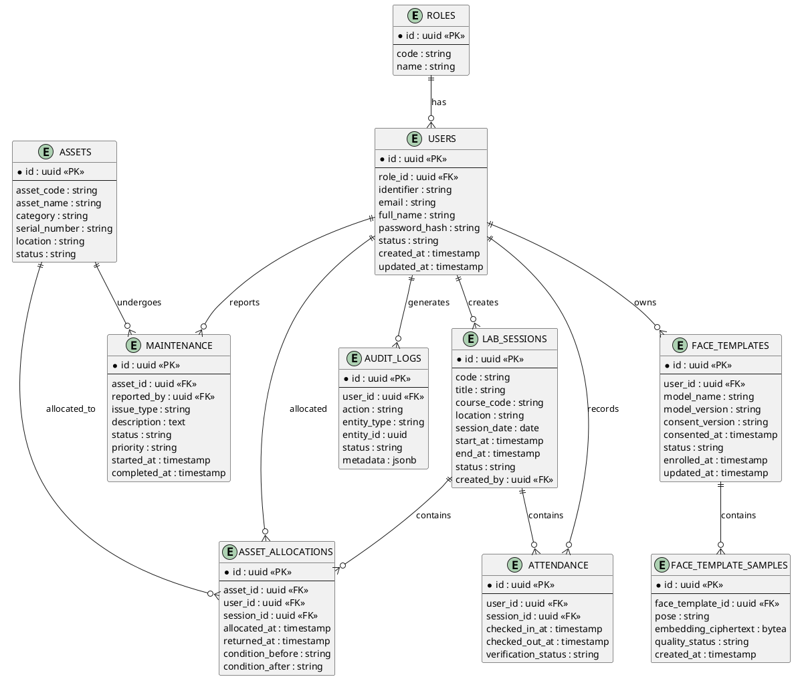

---

## 2. Sequence Diagram — Multi-Angle Enrollment dan Face Verification 1:1

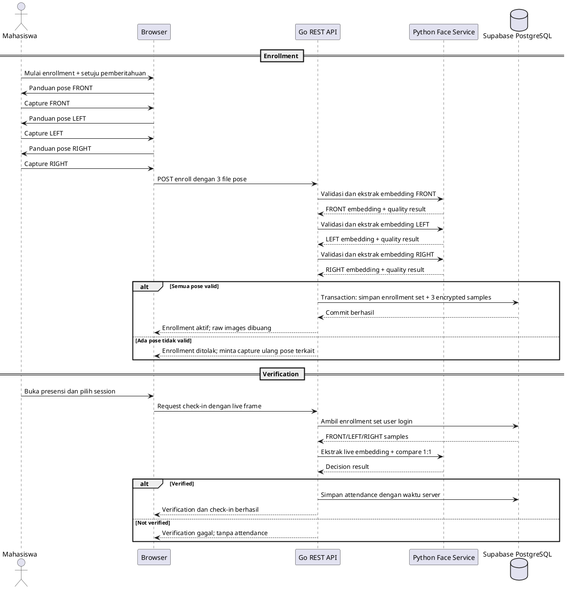

## 3. Sequence Diagram — Attendance (Check-in & Check-out)

Flow aktual endpoint `/api/v1/attendance/check-in` dan `/api/v1/attendance/check-out`.

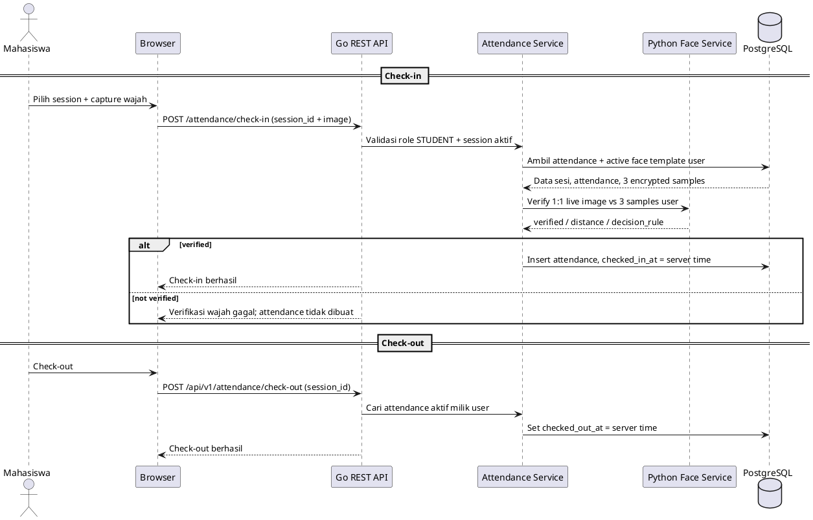

---

## 4. Activity Diagram — Login

Flow aktual `/api/v1/auth/login` dengan JWT HttpOnly cookie.

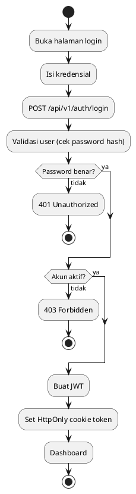

---

## 5. Activity Diagram — Face Enrollment Multi-Angle

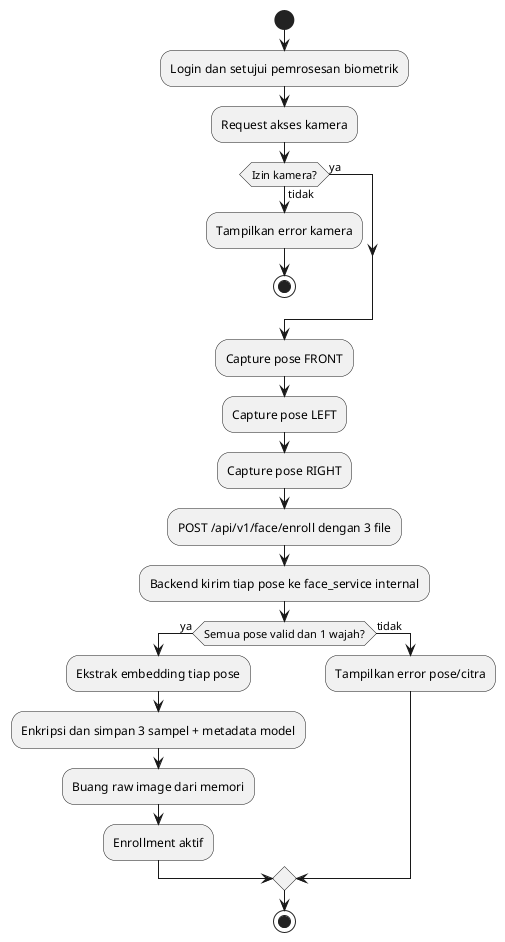

## 6. Component Diagram — Architecture (Layered)

Arsitektur aktual: React frontend memanggil Go Fiber API; Go API memanggil face_service internal.

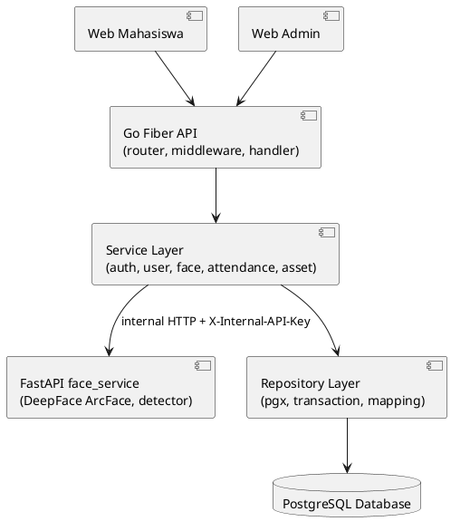

---

## 7. Deployment Diagram

Deployment target/logical runtime.

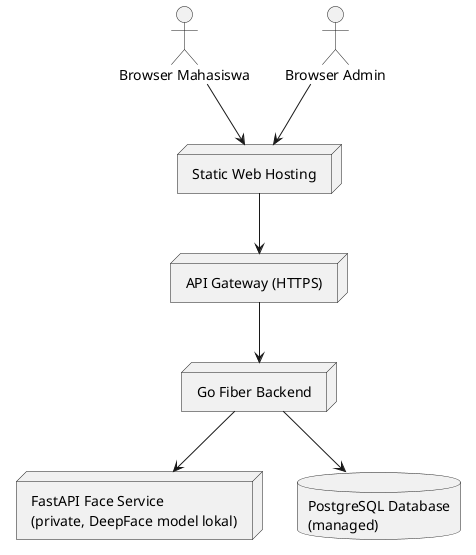

---

## 8. State Diagram — Status Asset

Status asset sesuai constraint database dan service allocation.

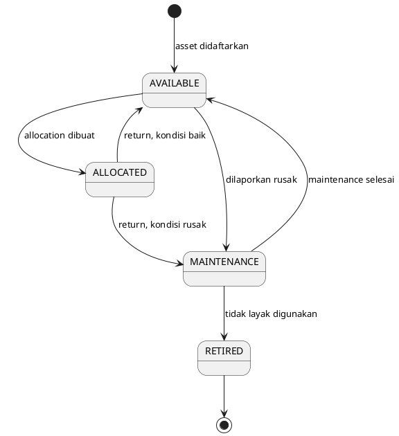

---

## 9. State Diagram — Status Maintenance

Status maintenance sesuai constraint database.

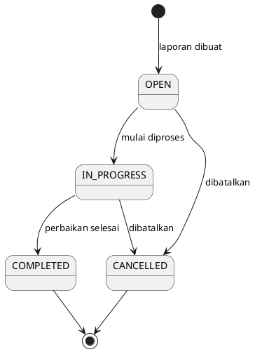

---

## 10. Gantt Chart — Rencana 7 Sprint

PRD 14.9. Tanggal hanya contoh — sesuaikan dengan kalender akademik. **Pakai `@startgantt`, bukan `@startuml`** (lihat catatan di atas kalau error di planttext.com).

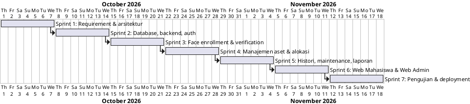

---

## 11. Class Diagram — Backend Service

Struktur service backend aktual (ringkas).

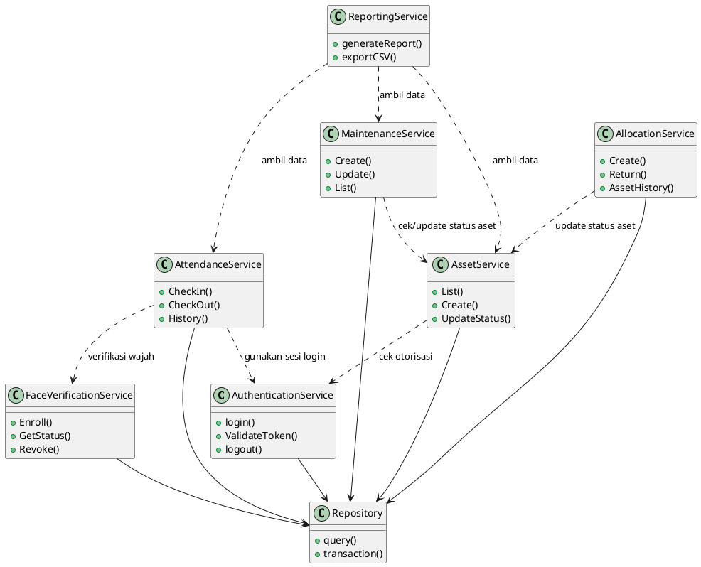

---

## 12. Activity Diagram — Swimlane Presensi

Pembagian tanggung jawab Mahasiswa vs Sistem. PlantUML punya sintaks swimlane native (`|NamaLane|`) — lebih rapi daripada versi gambar tangan sebelumnya.

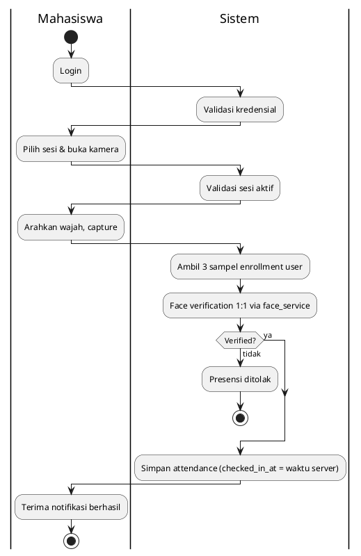

---

*Dibuat untuk Proyek 3 — Keyla S. & Ridwan H.*
